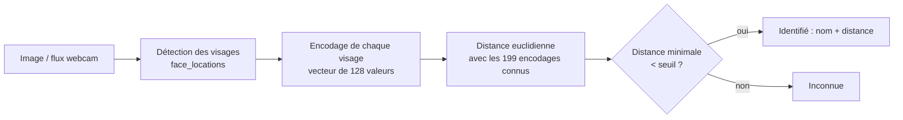

# Reconnaissance faciale — détection et identification de visages avec Streamlit

Application web de reconnaissance faciale en Python : elle détecte les visages dans une image ou un flux webcam, puis les identifie en les comparant à une base de personnes connues (extraite du jeu de données **LFW**). L'utilisateur peut régler la sévérité de la reconnaissance en direct.

<!-- Ajoute ici une capture d'écran ou un GIF de démonstration, par exemple : -->
<!--  -->

## Fonctionnalités

- **Trois modes d'entrée** : caméra en direct, photo prise avec la caméra, ou fichier image (JPG/PNG).
- **Détection multi-visages** : chaque visage est encadré et étiqueté (vert = reconnu, rouge = inconnu), avec sa distance au visage le plus proche.
- **Seuil de reconnaissance réglable** dans la barre latérale (de 0,30 à 0,80, 0,60 par défaut) : plus la valeur est petite, plus l'identification est stricte.
- **Flux vidéo fluide** : le traitement en direct analyse une image sur trois, sur une version réduite à 25 %.
- **Photos de téléphone gérées** : l'orientation EXIF est corrigée et les grandes images sont redimensionnées (1 000 px max).

## Comment ça marche



1. **Construction de la base** (notebook) : pour les 10 personnes les plus photographiées de LFW, jusqu'à 20 images par personne sont encodées avec `face_recognition`. Chaque visage devient un vecteur de 128 valeurs, stocké avec le nom de la personne dans `base_visages.pkl` (**199 encodages**).
2. **Reconnaissance** (application) : le visage détecté est encodé, puis comparé à tous les encodages de la base. Le plus proche donne le nom si sa distance est inférieure au seuil, sinon le visage est marqué « Inconnue ».

## Structure du dépôt

```
.
├── app_streamlit.py        # application Streamlit
├── facerecognation.ipynb   # construction de la base et essais de l'application
├── base_visages.pkl        # base de visages connus (noms + encodages)
├── requirements.txt        # dépendances
└── README.md
```

## Installation

**Prérequis** : Python 3.10 ou plus récent. La bibliothèque `face_recognition` s'appuie sur `dlib`, qui demande un compilateur C++ et CMake à l'installation :
- **Windows** : installer les « Outils de build C++ » de Visual Studio, puis `pip install cmake`.
- **macOS** : `brew install cmake`.
- **Linux (Debian/Ubuntu)** : `sudo apt install build-essential cmake`.

```bash
# 1. Cloner le dépôt
git clone https://github.com/Aya1106-Am/<nom-du-depot>.git
cd <nom-du-depot>

# 2. Créer et activer un environnement virtuel
python -m venv .venv
source .venv/bin/activate        # Windows : .venv\Scripts\activate

# 3. Installer les dépendances
pip install -r requirements.txt
```

> Avec `uv` : `uv venv` puis `uv pip install -r requirements.txt`.

Si l'avertissement `pkg_resources is deprecated` bloque le lancement, installe `pip install "setuptools<81"` (déjà inclus dans `requirements.txt`).

## Lancer l'application

```bash
streamlit run app_streamlit.py
```

Ouvre ensuite l'adresse affichée (par défaut http://localhost:8501). Pour l'onglet **Caméra en direct**, clique sur **START** et autorise l'accès à la caméra dans le navigateur.

## Reconstruire ou modifier la base de visages

Le fichier `base_visages.pkl` fourni suffit pour tester l'application. Pour construire ta propre base :

1. Télécharge LFW (version `lfw-deepfunneled`) depuis http://vis-www.cs.umass.edu/lfw/ et décompresse-le.
2. Dans `facerecognation.ipynb`, adapte `dossier_visages_connus` vers ce dossier.
3. Règle `max_personnes` (nombre de personnes) et `max_images` (images par personne).
4. Pour ajouter une personne qui n'est pas dans LFW, crée un dossier à son nom contenant ses photos et ajoute ce nom à `mes_dossiers`.
5. Exécute la cellule : elle régénère `base_visages.pkl`.

## Technologies

Python · `face_recognition` (dlib) · OpenCV · NumPy · Pillow · Streamlit · streamlit-webrtc · PyAV

## Limites

- **Base très réduite** : 10 personnes et 199 encodages seulement. Toute autre personne est classée « Inconnue » ou, plus rarement, confondue avec une personne de la base.
- **Pas d'évaluation chiffrée** à ce stade : aucune précision ni taux de faux positifs n'a été mesuré sur un jeu de test.
- **Biais du jeu de données** : LFW contient surtout des personnalités publiques photographiées de face, avec une diversité limitée ; les performances peuvent baisser selon la lumière, l'angle, le port de lunettes ou d'un masque.
- **Seuil fixe par défaut** (0,60) : il doit être ajusté selon le compromis voulu entre faux rejets et fausses identifications.
- **Données biométriques** : en usage réel, la reconnaissance faciale est soumise au RGPD (consentement, finalité, conservation) ; ne l'utilise pas sur des personnes sans leur accord.
- **Sécurité** : `base_visages.pkl` est un fichier pickle, à n'ouvrir que s'il provient d'une source de confiance.

## Pistes d'amélioration

- Mesurer la performance (précision, rappel, courbe ROC) sur un jeu de test séparé.
- Agrandir la base et comparer la distance minimale à une moyenne par personne.
- Essayer un détecteur CNN (`model="cnn"`) ou un modèle d'embedding plus récent.
- Journaliser les identifications et ajouter un mode « enregistrer une nouvelle personne » depuis l'interface.
- Conteneuriser l'application (Docker) pour un déploiement simplifié.

## Auteure

**Aya Ait Mohand** — étudiante en Master 2 IA2S, Université Paris-Est Créteil · [GitHub](https://github.com/Aya1106-Am) · [LinkedIn](https://www.linkedin.com/in/aya-ait-mohand-b91623231/)
